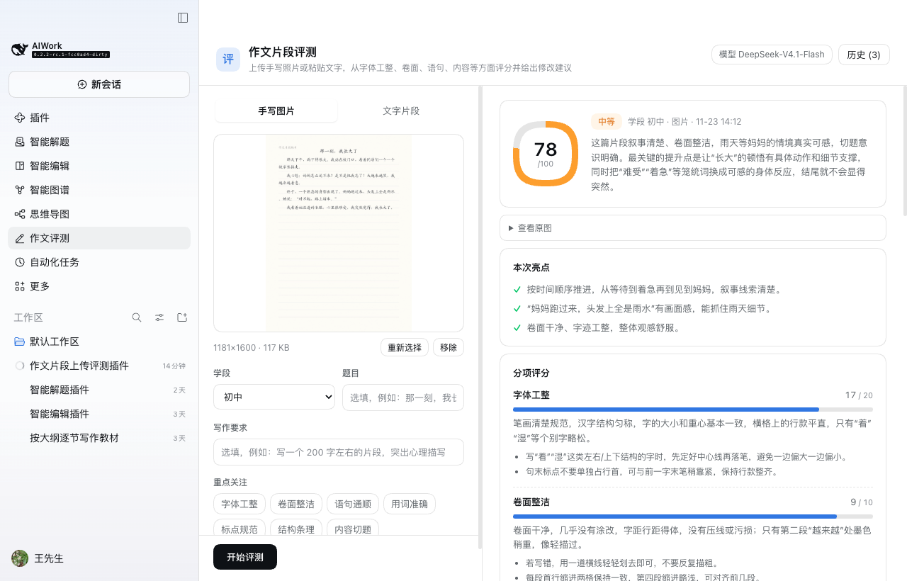
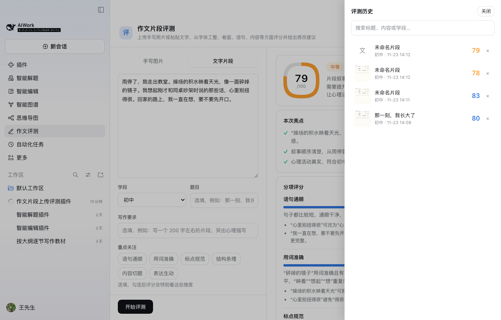

# 作文片段评测（dsh-plugin-essay-review）

DSH 插件：上传一张手写作文片段，或直接粘贴一段文字，按 **字体工整、卷面整洁、语句通顺、用词准确、标点规范、结构条理、内容切题** 等维度评分，并给出可以照着改的建议。

- 侧栏入口「作文评测」，打开全幅面板；
- 图片支持点击选择、拖拽、剪贴板粘贴，自动压缩到长边 1600；
- 结果包含总分/等级、逐维度分数与建议、问题清单、升格示范、下一步练习；
- 历史记录可搜索、回看、删除，数据和图片保存在本机 profile；
- Agent 也可以用 `essay_review__*` 工具评测文字或本地图片。



| 文字模式 | 历史记录 |
| --- | --- |
|  |  |


## 安装

```sh
dsh plugin --profile <profile> add /absolute/path/to/essay-review-plugin
```

或在插件管理里安装本地路径。安装后刷新页面，左侧栏出现「作文评测」。

桌面端在宿主启动时缓存 boot injections：新装的插件通常经 HMR 立即出现在当前页面；如果刷新后侧栏仍没有入口，重启一次应用即可。宿主是否已收录浏览器半边可以用
`GET /api/essay-review/client-status` 查（返回 `clientPath` 表示已收录）。

## 配置（cordis 行）

| 键 | 默认 | 说明 |
| --- | --- | --- |
| `provider` / `model` | 跟随 Agent 默认模型 | 两者必须同时出现；想专门指定视觉模型时使用 |
| `reasoningEffort` | 模型默认最低档 | 可选，提高推理投入 |
| `maxOutputTokens` | `4096` | 单次评测的输出上限 |
| `timeoutMs` | `240000` | 单次评测超时 |
| `maxImageBytes` | `12582912`（12 MB） | 原图上限 |
| `maxTextChars` | `20000` | 文字片段上限 |
| `dataDir` | `<profile>/essay-review-workshop` | 记录与图片目录 |

## 维度与满分

图片模式（合计 100）：字体工整 20、卷面整洁 10、语句通顺 15、用词准确 10、标点规范 5、结构条理 15、内容切题 25。

文字模式（合计 100）：语句通顺 20、用词准确 15、标点规范 10、结构条理 20、内容切题 20、表达生动 15。

总分 = 各维度得分之和；等级：≥90 优秀、80–89 良好、70–79 中等、60–69 及格、<60 待提高。

## 手写照片需要视觉模型

「字体工整」和「卷面整洁」只能从图片判断。当前模型不支持图片输入时，插件会返回
`model/no-vision` 并提示改用文字模式；它不会假装看得见图。

可以在模型设置里给当前模型打开图片输入，也可以在插件配置里单独钉一个支持图片的
provider/model（例如其它视觉模型），不影响对话使用的默认模型。

## HTTP 接口（界面使用）

| 方法与路径 | 用途 |
| --- | --- |
| `GET /api/essay-review/config` | 模型能力、维度表、学段、限制 |
| `POST /api/essay-review/evaluate` | 评测（`mode: image \| text`） |
| `GET /api/essay-review/reviews` | 历史列表（`q` 搜索） |
| `GET /api/essay-review/review?id=` | 单条记录 |
| `POST /api/essay-review/delete` | 删除记录与图片 |
| `GET /api/essay-review/image?id=` | 记录原图 |

## Agent 工具

- `essay_review__evaluate_text`：评测文字片段；
- `essay_review__evaluate_image`：评测本机图片（绝对路径）；
- `essay_review__list_reviews` / `essay_review__get_review` / `essay_review__delete_review`：历史记录。

随包附带 `skill/SKILL.md`，加载后 Agent 知道何时调用这些工具。

## 开发与测试

```sh
node --test tests/host.test.mjs
REACT_PATH=/path/to/a/package/with/react node --test tests/client.smoke.mjs
```

宿主测试用假的 Cordis Context 覆盖路由、归一化、错误分支和工具；浏览器测试用宿主同款
React 做静态渲染，验证插槽注册与结果视图。插件本身零运行时依赖、零构建步骤：宿主是
普通 ESM，浏览器半边是一个 `window.__ModuleLoader__.load({ factory })` 包装的 CJS 工厂。
